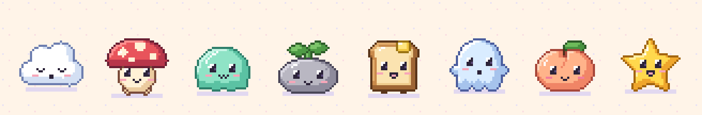

# TAMA: Made by You



A 1990s Tamagotchi reimagined with conversational AI and reinforcement learning. Built for KCL FirstYearHack 2026, Retro Remix.

Hatch one of eight pixel pets, raise it from baby to adult in real time, customise the shell, chat in four modes, and use supported browser voice input and speech output. Core pet interactions and chat remain available through local fallback responses when no Gemini API key is configured.

## Run locally

```bash
npm install
cp .env.example .env
# Optional: add GEMINI_API_KEY to .env
npm run dev
```

Open <http://localhost:5173>. `npm run dev` starts Vite and the local Express chat server. The API key is read by the server, not the browser.

## Deploy to GitHub Pages

`.github/workflows/deploy.yml` tests, builds and publishes the site on every push to `main`.

One-time setup: in the GitHub repo, go to **Settings > Pages > Build and deployment** and set **Source** to **GitHub Actions**. The site then appears at `https://<user>.github.io/<repo>/`.

GitHub Pages only serves static files, so the Gemini chat server doesn't run there; the pet answers with its built-in replies instead.

## Commands

```bash
npm test
npm run build
npm run lint
npm run dev:frontend
npm run dev:server
```

## Navigation and features

The application uses hash routes with no router dependency:

- **Home (`#/`)** introduces TAMA and links into the game.
- **About (`#/about`)** shows the pet gallery, shell gallery, and an interactive learning explainer.
- **My Pet (`#/play`)** is the game: hatch and care for a pet, switch its conversation mode, use its device controls, and view its learning state.

Conversation modes are **Silly** (jokes and a guessing game), **Serious** (task breakdown), **Study** (focus timer and quiz), and **Companion** (opt-in saved facts). The device supports feed, play, rest, study, chat, stats, shell, and attention controls. Voice input and output use the browser's Web Speech API when supported; typing remains available when voice input is unavailable.

## Contextual-bandit Q-learning

`src/game/rl.ts` runs a one-step contextual bandit (Q-learning with gamma 0) to choose a suggestion, not to run the pet simulation. It observes 32 contexts: four times of day × hungry/not hungry × tired/not tired × sad/not sad. In each context it scores four actions: feed, play, rest, and chat.

- Follow a pending suggestion: **+1**
- Do another activity while a suggestion is pending: **−0.25**
- Let a suggestion expire: **−0.5**

Each outcome updates the suggested action's value with `Q(s,a) ← Q(s,a) + α(reward − Q(s,a))`, where `α = 0.25`. Epsilon-greedy selection starts with 35% exploration and decays to a 5% minimum. Care performed with no pending suggestion receives a smaller habit observation. The game logic, rather than the learner, owns needs and evolution.

## How it lives

TAMA follows the rules of the classic handhelds, on the real clock:

- **Real time.** Its needs keep changing while the tab is closed, in half-hour steps. It sleeps from 22:00 to 07:00, when it barely changes.
- **Growing up.** Baby for the first hour, child for the first day, teen until day 3, then an adult. Its leading trait (Curiosity, Playfulness or Friendship, shaped by how you care for it) decides the adult form: Scholar, Chaos Sprite or Buddy.
- **Poop and sickness.** It poops every three waking hours (every hour as a baby). Poop left for an hour and a half makes it sick, and a sick pet needs medicine.
- **Death.** Left starving and miserable, or sick for six hours without medicine, it becomes a ghost. With no care at all that's about a day. You can revive each pet once; after that it's a new egg.
- **Care mistakes.** Letting hunger or happiness run all the way out counts as one, shown in its stats.

Everything is played on the device itself: A moves between the eight icons (Feed, Play, Lights, Clean, Medicine, Talk, Stats, Attention), B uses one, C goes back or pats. A short guide points at each control after your first hatch. Sounds are generated in the browser and can be switched off.

Demo mode (in Stats) runs the same rules 60 times faster, and the growth stages in minutes, for showing it off.

## Project layout

```text
src/
  ai/             Gemini client, prompts, and response types
  art/            pixel pets, scenes, and shell skins
  components/     pages, Tamagotchi controls, activities, and panels
  game/           care, life clock, growth, activities, habits, study timer, and Q-learning
  voice/          browser speech hook and saved voice preferences
  sound/          handheld-style beeps made with the Web Audio API
  styles/         retro theme
server/           Express Gemini proxy and fallback handling
docs/             README art (animated pet GIFs)
```
